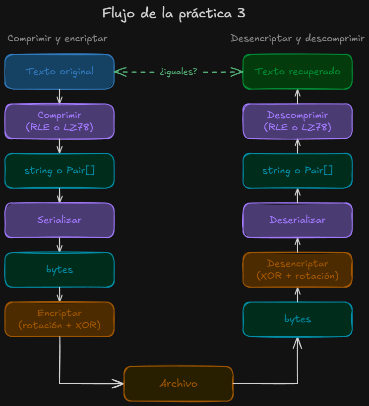

# ByteSqueeze

Lossless compression (RLE, LZ78) + bitwise encryption (rotation + XOR) in C++ from scratch. Informática II, UdeA.

Both compression algorithms and the LZ78 dictionary are implemented by hand with
manual memory management (`new` / `delete`), without STL containers.

## Authors

- Juan Camilo Lopez Castrillon
- Juan David Acevedo

## Features

- **RLE (Run-Length Encoding):** each run of equal characters is stored as a
  3-byte record `[count high][count low][symbol]`, supporting runs of up to 65,535.
- **LZ78:** dictionary-based compression that emits `(index, symbol)` pairs, using a
  hand-made dynamic dictionary that doubles its capacity when full.
- **Encryption:** every byte is rotated `n` bits to the left and then XORed with a
  key `K`. Decryption applies the inverse steps in reverse order.
- **Error handling:** custom exceptions for invalid parameters and corrupted data
  (for example, decrypting with the wrong key or method).

## Program flow



**Option 1: compress and encrypt**

1. Read the original text file.
2. Compress it with RLE or LZ78.
3. Serialize the compressor output into a flat byte array.
4. Encrypt the bytes (rotate left `n` bits, then XOR with `K`).
5. Save the result to `encrypted.txt`.

**Option 2: decrypt and decompress**

1. Read the encrypted file.
2. Decrypt the bytes (XOR with `K`, then rotate right `n` bits).
3. Deserialize the bytes back into the compressor format.
4. Decompress with the same method.
5. Save the recovered text to `decrypted.txt`.

The same method, `n` and `K` must be used in both steps. The recovered file is
byte-for-byte identical to the original.

## Serialized format

Both methods produce 3-byte records before encryption:

| Method | Byte 1     | Byte 2    | Byte 3 |
|--------|------------|-----------|--------|
| RLE    | count high | count low | symbol |
| LZ78   | index high | index low | symbol |

## Building

Requires a C++17 compiler and CMake 3.16+.

```bash
cmake -S . -B build
cmake --build build
```

Or compile directly with g++:

```bash
g++ -std=c++17 -Wall -Wextra *.cpp -o bytesqueeze
```

The project can also be opened in Qt Creator through `CMakeLists.txt`.

## Usage

```
===== ByteSqueeze: Compression and encryption =====
1. Compress and encrypt a file
2. Decrypt and decompress a file
0. Exit
Option: 1
Text file to encrypt: example.txt
Compression method (1 = RLE, 2 = LZ78): 2
Bits to rotate n (1-7): 3
Key K (0-255): 171

Original size:   99 bytes
Compressed size: 171 bytes
Encrypted file saved to: encrypted.txt
```

Output files are created in the program's working directory.

## Project structure

| File | Description |
|------|-------------|
| `main.cpp` | Menu, file I/O and the full pipeline |
| `RLE.h` / `RLE.cpp` | Run-Length Encoding |
| `LZ78.h` / `LZ78.cpp` | LZ78 and its dynamic dictionary |
| `Serialization.h` / `Serialization.cpp` | Conversion between compressor output and byte arrays |
| `Encryption.h` / `Encryption.cpp` | Bit rotation + XOR encryption |
| `NOTAS.md` | Detailed study notes (in Spanish) |

## Limitations

- RLE only reduces size when the text has runs of more than 3 equal characters;
  on regular text, the output can be up to 3 times larger than the input.
- LZ78 uses `'\0'` as an end-of-text marker, so it is meant for plain text files,
  not binary files.
- LZ78 indices are stored in 2 bytes, which limits the dictionary to 65,535 entries.
